# 📦 Diagrama de Paquetes y Estrategia Inicial de Pruebas
## Proyecto: AeroControl Ops — Sistema de Gestión y Control de Operaciones Aeroportuarias
**Curso / Asignatura:** Práctica de Campo — Ingeniería de Software / Calidad de Software  
**Estándares de Referencia:** UML 2.5, ISO/IEC 25010:2023, IEEE 29148, WCAG 2.1 (Nivel AA)

---

## 📑 1. DIAGRAMA DE PAQUETES (UML Package Diagram)

### 1.1 Justificación Arquitectónica
El sistema **AeroControl Ops** implementa una arquitectura desacoplada en capas (Layered Architecture) compuesta por:
1. **Capa de Presentación (Frontend SPA):** Módulos visuales, interfaz reactiva sin recarga, simulador de radar en Canvas 2D y servicios cliente de comunicación.
2. **Capa de Aplicación y Servicios (Backend REST API):** Middleware de seguridad, enrutamiento, controladores de dominio y lógica de coordinación de vuelos/recursos.
3. **Capa de Persistencia y Acceso a Datos (Data Access Layer - DAL):** Repositorios parametrizados y proveedores de base de datos híbridos (SQLite para contingencia/demostración y MySQL para producción).
4. **Capa Transversal / Seguridad y Auditoría:** Autenticación RBAC, hashing, manejo de sesiones y registro inmutable en bitácora.

---

### 1.2 Representación en Diagrama de Paquetes (Mermaid)

```mermaid
graph TD
    %% ==========================================
    %% CAPA PRESENTACIÓN (CLIENTE - SPA)
    %% ==========================================
    subgraph CP ["📦 Capa de Presentación (Frontend Client SPA)"]
        subgraph P_UI ["📦 com.aerocontrol.ui.views"]
            V_DASH["DashboardView (index.html)"]
            V_RADAR["RadarSimulatorView (torre_control_simulador.html)"]
            V_MODALS["OperationalModals (Vuelos, Incidencias, Reportes)"]
        end

        subgraph P_CLIENT_SVC ["📦 com.aerocontrol.ui.services"]
            SVC_API["ApiClient (Fetch / HTTP Client)"]
            SVC_AUTH["AuthService (Session & RBAC Client)"]
            SVC_SYNC["RadarSyncService (Window postMessage)"]
            SVC_TOAST["NotificationService (Toasts & Alerts)"]
        end

        subgraph P_A11Y ["📦 com.aerocontrol.ui.accessibility"]
            A11Y_FOCUS["FocusTrapManager"]
            A11Y_ARIA["AriaLiveAnnouncer"]
            A11Y_CONTRAST["HighContrastThemeController"]
        end
    end

    %% ==========================================
    %% CAPA APLICACIÓN / BACKEND REST API
    %% ==========================================
    subgraph CA ["📦 Capa de Aplicación (Backend REST API - Node.js)"]
        subgraph P_SECURITY ["📦 com.aerocontrol.backend.security"]
            MW_AUTH["SessionAuthMiddleware (Cookie HttpOnly)"]
            MW_RBAC["RoleAuthorizationMiddleware"]
            SEC_HASH["CryptoHasher (SHA-256 / Password Validator)"]
        end

        subgraph P_ROUTERS ["📦 com.aerocontrol.backend.controllers"]
            CTRL_AUTH["AuthController (/api/auth)"]
            CTRL_VUELOS["VuelosController (/api/vuelos)"]
            CTRL_INCIDENCIAS["IncidenciasController (/api/incidencias)"]
            CTRL_RECURSOS["RecursosController (/api/recursos)"]
            CTRL_REPORTES["ReportesController (/api/reportes)"]
            CTRL_SOLICITUDES["SolicitudesController (/api/solicitudes-operativas)"]
            CTRL_BITACORA["BitacoraController (/api/bitacora)"]
        end

        subgraph P_DOMAIN ["📦 com.aerocontrol.backend.domain.services"]
            DOM_SAFETY["SafetyGateService (Detección de conflictos de puerta)"]
            DOM_ROTATION["FlightRotationService (Ciclo Llegada -> Salida)"]
            DOM_AUDIT["AuditLogService (Trazabilidad DNI y Timestamp)"]
        end
    end

    %% ==========================================
    %% CAPA ACCESO A DATOS (DAL)
    %% ==========================================
    subgraph CD ["📦 Capa de Acceso a Datos (Data Access Layer - DAL)"]
        subgraph P_DAL ["📦 com.aerocontrol.data.repositories"]
            REPO_VUELOS["VuelosRepository"]
            REPO_INCIDENCIAS["IncidenciasRepository"]
            REPO_RECURSOS["RecursosRepository"]
            REPO_USUARIOS["UsuariosRepository"]
            REPO_BITACORA["BitacoraRepository"]
        end

        subgraph P_DB_ADAPTERS ["📦 com.aerocontrol.data.adapters"]
            ADAPTER_SQLITE["SQLiteAdapter (node:sqlite DatabaseSync)"]
            ADAPTER_MYSQL["MySQLAdapter (mysql2 / Connection Pool)"]
        end
    end

    %% ==========================================
    %% RELACIONES Y DEPENDENCIAS ENTRE PAQUETES
    %% ==========================================
    P_UI -.->|use| P_CLIENT_SVC
    P_UI -.->|use| P_A11Y
    P_CLIENT_SVC -.->|HTTP / JSON REST| P_ROUTERS
    
    P_ROUTERS -.->|verify| P_SECURITY
    P_ROUTERS -.->|invoke| P_DOMAIN
    P_DOMAIN -.->|use| P_DAL
    P_ROUTERS -.->|query / persist| P_DAL
    
    P_DAL -.->|delegate| P_DB_ADAPTERS
```



### 1.3 Descripción Detallada de Paquetes
* **`com.aerocontrol.ui.views`**: Contiene las interfaces visuales renderizadas por el navegador. El archivo [`index.html`](file:///C:/Users/User/Desktop/aerocontrol-ops-fullstack-main/public/index.html) encapsula el dashboard con paneles de vuelos, incidentes, recursos, solicitudes operativas y analítica. [`torre_control_simulador.html`](file:///C:/Users/User/Desktop/aerocontrol-ops-fullstack-main/public/torre_control_simulador.html) es la vista autónoma de radar con visualización Canvas 2D.
* **`com.aerocontrol.ui.services`**: Administra la comunicación asíncrona hacia los endpoints REST, el control de token de sesión vía cookies, y el canal de mensajería `postMessage` bidireccional entre la torre y el dashboard principal.
* **`com.aerocontrol.ui.accessibility`**: Módulo especializado en la gestión de foco por teclado, alertas vivas (`aria-live="polite|assertive"`) y soporte de accesibilidad conforme a la norma WCAG 2.1 AA.
* **`com.aerocontrol.backend.security`**: Filtros y middlewares interceptores que validan la existencia de la sesión activa, sanitizan cabeceras y aplican control RBAC (Administrador, Supervisor, Operador, Torre de Control).
* **`com.aerocontrol.backend.controllers`**: Despachadores HTTP nativos de [`server.mjs`](file:///C:/Users/User/Desktop/aerocontrol-ops-fullstack-main/server.mjs) y [`server-mysql.mjs`](file:///C:/Users/User/Desktop/aerocontrol-ops-fullstack-main/server-mysql.mjs) que resuelven los endpoints `/api/*`.
* **`com.aerocontrol.backend.domain.services`**: Reglas de negocio críticas del aeropuerto: prevención de colisión de aeronaves en misma puerta y hora, control de clima que retrasa aproximaciones, y trazabilidad inmutable de acciones.
* **`com.aerocontrol.data.repositories` y `adapters`**: Encapsulan la persistencia ejecutando sentencias SQL preparadas (`Prepared Statements`) para garantizar inmunidad a inyecciones SQL en SQLite o MySQL.

---

## 🧪 2. ESTRATEGIA INICIAL DE PRUEBAS

La estrategia se fundamenta en la **Pirámide de Pruebas de Mike Cohn** combinada con los atributos de calidad de la norma **ISO/IEC 25010** (Seguridad, Fiabilidad, Protección y Usabilidad/Accesibilidad):

```text
               / \
              /   \      Pruebas de Aceptación (UAT / HU-01 a HU-08)
             / UAT \     
            /-------\    Pruebas de Accesibilidad (WCAG 2.1 AA / Lighthouse)
           /  A11Y   \   
          /-----------\  Pruebas Funcionales y de Integración (API REST)
         / Funcionales \ 
        /---------------\
       /    Unitarias    \ Pruebas Unitarias (Funciones, Algoritmos, Hashing)
      /-------------------\
```

---

### 2.1 Pruebas Unitarias (Unit Testing)

* **Objetivo:** Verificar de forma aislada la lógica algorítmica, validaciones y transformaciones de datos sin depender de red ni de base de datos activa.
* **Herramienta recomendada:** Módulo nativo `node:test` y `node:assert` (estándar en Node.js v24).
* **Alcance de los componentes a probar:**
  1. **Algoritmo de Detección de Conflicto en Radar:** Cálculo de distancia euclidiana entre dos aeronaves en aproximación ($\sqrt{(x_2-x_1)^2 + (y_2-y_1)^2} < \text{umbral}$).
  2. **Validador de Formatos Aeronáuticos:** Expresiones regulares para códigos de vuelo IATA (ej. `LA2045`, `AV120`, `IB6651`), formato de hora `HH:MM` y DNI (8 dígitos numéricos).
  3. **Generador de Hash de Contraseña:** Función criptográfica `createHash("sha256")` para asegurar predictibilidad y descarte de textos planos.
  4. **Sanitizador XSS (`escapeHtml`):** Comprobación de neutralización de caracteres especiales (`<`, `>`, `&`, `"`, `'`).

#### Ejemplo de Caso de Prueba Unitaria (`test/unit_test.mjs`):
```javascript
import { test } from "node:test";
import assert from "node:assert/strict";

// Función de validación de código IATA/ICAO
function isValidFlightCode(code) {
  return /^[A-Z0-9]{2,3}\d{3,4}$/.test(code);
}

// Algoritmo de proximidad en radar (Canvas)
function checkRadarCollision(p1, p2, minDistance = 50) {
  const dist = Math.hypot(p1.x - p2.x, p1.y - p2.y);
  return dist < minDistance;
}

test("Validación de código de vuelo IATA", () => {
  assert.equal(isValidFlightCode("LA2045"), true);
  assert.equal(isValidFlightCode("IB6651"), true);
  assert.equal(isValidFlightCode("INVALIDO_123"), false);
});

test("Detección de alerta de colisión en radar de Torre de Control", () => {
  const avionA = { x: 100, y: 150 };
  const avionB = { x: 120, y: 160 }; // Distancia aprox: 22.36 px (< 50)
  const avionC = { x: 300, y: 400 };

  assert.equal(checkRadarCollision(avionA, avionB), true, "Debe generar alerta de proximidad peligrosa");
  assert.equal(checkRadarCollision(avionA, avionC), false, "Aviones separados no deben emitir alerta");
});
```

---

### 2.2 Pruebas Funcionales y de Integración (Functional & Integration Testing)

* **Objetivo:** Validar que los endpoints de la API REST respondan correctamente a los flujos del negocio, preserven las restricciones de integridad relacional, gestionen las cookies de sesión y apliquen la matriz de control de acceso por roles (RBAC).
* **Herramienta:** Script de integración automatizado en Node.js ([`scripts/verify_user_stories.mjs`](file:///C:/Users/User/Desktop/aerocontrol-ops-fullstack-main/scripts/verify_user_stories.mjs)).
* **Casos de prueba funcionales priorizados:**

| ID Caso | Módulo / Endpoint | Precondición | Acción / Entrada | Resultado Esperado |
| :--- | :--- | :--- | :--- | :--- |
| **TC-F01** | `/api/auth/login` | Usuario existente en BD | POST con DNI `12345678` y clave `Admin123` | HTTP 200, cookie `aerocontrol_session` emitida con flags `HttpOnly; SameSite=Lax`. |
| **TC-F02** | `/api/auth/login` | Usuario existente | POST con contraseña errónea | HTTP 401 Unauthorized, mensaje *"Credenciales inválidas"*, sin cookie. |
| **TC-F03** | `/api/vuelos` | Sesión activa de Operador | POST nuevo vuelo `{"codigo": "LA2099", "ruta": "LIM-CUZ", "hora": "15:30", "puerta": "G04", "estado": "En hora", "tipo": "Salida"}` | HTTP 201 Created, registro visible en base de datos e ID generado. |
| **TC-F04** | `/api/vuelos` | Vuelo `LA2099` ya existe | POST duplicado con código `LA2099` | HTTP 400/409, rechazo por restricción `UNIQUE` en código. |
| **TC-F05** | `/api/solicitudes-operativas` | Vuelo entrante registrado | POST solicitud de rotación de aeronave para vuelo de salida | HTTP 201, estado inicial `"Pendiente"` y notificación disponible para Torre de Control. |
| **TC-F06** | `/api/bitacora` | Mutación de vuelo realizada | GET `/api/bitacora` con rol Administrador | HTTP 200, array JSON donde el primer elemento registra la acción, el DNI autor y el timestamp. |
| **TC-F07** | Control RBAC | Sesión iniciada con rol Operador | DELETE `/api/usuarios/:id` | HTTP 403 Forbidden (el rol Operador no tiene permisos de administración). |

---

### 2.3 Pruebas de Aceptación (User Acceptance Testing - UAT)

* **Objetivo:** Demostrar que el software satisface las necesidades de los usuarios finales (Controladores de Torre, Operadores de Rampa, Supervisores y Administradores de CORPAC) en base a los criterios de aceptación de las Historias de Usuario (HU-01 a HU-08).
* **Metodología:** Enfoque BDD / Criterios de Aceptación estructurados bajo la sintaxis **Dado - Cuando - Entonces (Given - When - Then)**.

#### Matriz de Criterios de Aceptación:
1. **HU-01: Gestión de Vuelos en Tiempo Real**
   * **Dado** que un Operador de Vuelos ha iniciado sesión en el sistema.
   * **Cuando** actualiza el estado del vuelo `LA2045` a `"Retrasado"` debido a condiciones climáticas.
   * **Entonces** el sistema debe reflejar inmediatamente el cambio en la tabla de operaciones, actualizar el semáforo a color ámbar y dejar constancia en la bitácora.
2. **HU-03: Detección y Prevención de Conflictos de Puerta (Safety Gate)**
   * **Dado** que la puerta `G02` se encuentra ocupada por un vuelo programado a las `14:00`.
   * **Cuando** un usuario intenta asignar a esa misma puerta otro vuelo con horario conflictivo (`14:05`).
   * **Entonces** el sistema debe emitir una advertencia de bloqueo operacional impidiendo la doble asignación y sugiriendo una puerta libre.
3. **HU-05: Autorización de Salida y Sincronización Torre-Radar**
   * **Dado** que existe una solicitud operativa de salida autorizada por el controlador de Torre.
   * **Cuando** el controlador presiona *"Autorizar Salida"*.
   * **Entonces** la solicitud pasa a estado `"Aprobada"`, el radar 2D genera dinámicamente la traza de la aeronave despegando en la pista 16L y se notifica al dashboard vía `postMessage`.
4. **HU-06: Confidencialidad y Control de Acceso por Roles**
   * **Dado** que un usuario ingresa al sistema.
   * **Cuando** se examina la respuesta de `/api/usuarios` o el tráfico de red.
   * **Entonces** en ningún caso debe exponerse el `password_hash` del usuario, y solo los módulos permitidos para su rol deben estar activos en el menú.

---

### 2.4 Pruebas de Accesibilidad (Accessibility Testing - A11Y)

* **Objetivo:** Garantizar que el sistema sea operable por personas con discapacidad y cumpla con el estándar internacional **WCAG 2.1 Nivel AA** y las directrices del **ODS 10 (Reducción de Desigualdades)**.
* **Herramientas:** Google Lighthouse (Auditoría A11Y), extensión axe DevTools, y prueba con lector de pantalla (NVDA / Windows Narrator).

#### Dimensiones Evaluadas y Criterios:
1. **Percepción - Contraste de Color (WCAG Criterio 1.4.3):**
   * El ratio de contraste entre el texto y el fondo debe ser de al menos **4.5:1** para texto normal y **3:1** para textos grandes e insignias de estado (badges verdes, ámbar y rojos con alto contraste).
2. **Operabilidad - Navegación Completa por Teclado (WCAG Criterio 2.1.1):**
   * Todas las acciones críticas (iniciar sesión, cambiar pestañas, confirmar autorizaciones de vuelo, cerrar modales) deben ser 100% ejecutables con las teclas `Tab`, `Shift+Tab`, `Enter`, `Space` y `Escape`.
   * Existencia de un anillo de enfoque visual claro (`:focus-visible`).
3. **Comprensión - Semántica y Formularios (WCAG Criterio 3.3.2):**
   * Todos los campos de entrada (`<input>`, `<select>`) deben contar con etiquetas descriptivas asociadas (`<label for="...">`).
4. **Robustez - Atributos ARIA (WCAG Criterio 4.1.2 y 4.1.3):**
   * Los modales deben implementar `role="dialog"` y `aria-modal="true"`.
   * Los mensajes de alerta emergente y cambios de estado en el radar deben utilizar `aria-live="polite"` o `role="status"` para que los lectores de pantalla anuncien el evento sin necesidad de recargar la página.

---

## 📈 3. MÉTRICAS DE CALIDAD DEL SOFTWARE (ISO/IEC 25010)

Para asegurar la calidad del producto y su gobernanza durante las prácticas de campo, se establecen las siguientes métricas cuantitativas:

| Característica ISO 25010 | Métrica Concreta | Fórmula / Método de Cálculo | Meta / Umbral Aceptable | Herramienta de Medición |
| :--- | :--- | :--- | :---: | :--- |
| **Fiabilidad / Calidad de Pruebas** | **Cobertura de Código (Code Coverage)** | $\frac{\text{Líneas de código ejecutadas por tests}}{\text{Total de líneas de código}} \times 100$ | $\ge 80\%$ | Node.js Test Runner / c8 |
| **Fiabilidad / Funcionalidad** | **Tasa de Aprobación de Pruebas (Pass Rate)** | $\frac{\text{Casos de prueba exitosos}}{\text{Total de casos ejecutados}} \times 100$ | $100\%$ en pruebas de regresión | [`verify_user_stories.mjs`](file:///C:/Users/User/Desktop/aerocontrol-ops-fullstack-main/scripts/verify_user_stories.mjs) |
| **Mantenibilidad** | **Densidad de Defectos (Defect Density)** | $\frac{\text{Defectos encontrados}}{\text{Líneas de código en miles (KLOC)}}$ | $< 0.5 \text{ defectos/KLOC}$ | Issue Tracker / Registro de pruebas |
| **Rendimiento** | **Latencia Media de la API REST** | Tiempo transcurrido entre el envío del request HTTP y la recepción del response JSON. | $\le 200\text{ ms}$ (Percentil 95) | Network Tab / `performance.now()` |
| **Usabilidad / Accesibilidad** | **Puntaje de Accesibilidad Lighthouse** | Puntuación ponderada de accesibilidad generada por Google Lighthouse (WCAG 2.1 AA). | $\ge 90 / 100$ puntos | Google Chrome Lighthouse |
| **Seguridad** | **Trazabilidad de Mutaciones (No Repudio)** | $\frac{\text{Operaciones de escritura en bitácora}}{\text{Total de mutaciones (POST/PUT/DELETE)}} \times 100$ | $100\%$ | Auditoría en tabla `bitacora` |
| **Seguridad** | **Inmunidad a Inyecciones SQL** | $\frac{\text{Consultas SQL con Prepared Statements (?)}}{\text{Total de consultas SQL}} \times 100$ | $100\%$ | Análisis estático de código |

---

## 🚀 4. Conclusión para la Entrega Académica

Con esta entrega se deja consolidada:
1. **La visión estructural del software:** Mediante el diagrama de paquetes UML, que evidencia una separación formal de responsabilidades entre la interfaz SPA, la lógica de negocio, la capa de seguridad RBAC y la persistencia híbrida.
2. **El plan de aseguramiento de calidad:** A través de una estrategia de pruebas multinivel (Unitarias, Funcionales, UAT y Accesibilidad) que respalda las operaciones críticas aeroportuarias de acuerdo con las normas internacionales **ISO/IEC 25010** e **IEEE 29148**.
