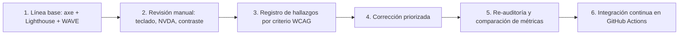

# Informe de calidad de inclusión: software de accesibilidad

**Proyecto:** AeroControl Ops (repositorio `deviecpalinnaherbacioalvarez-oss/Aerocontrol`)
**Curso:** Calidad y Software · **Docente:** Mg. Gerardo Sarmiento Quistán
**Autores (Apellidos, Nombres y Código):**
- Barreto Figueroa, Rodrigo Fernando — N00229073
- Guillermo Vallejos, Axel Jeremy — N00395089
- Herbacio Alvarez, Deviec Palinña — N00385196
- Prado Curipaco, Miguel Adrian — N00380861
- Zapata Lopez, Mauro Marcos — N00319248

**Alcance evaluado:** `public/index.html` (login, panel, vuelos, programación, tráfico, recursos, reportes, perfil y modales), `public/torre_control_simulador.html` y `public/surface-radar.js` (radar de superficie).
**Fecha:** noviembre 2026 (Versión 2.0)

---

## 1. Objetivo

Comprobar que AeroControl Ops puedan usarlo personas con discapacidad visual, motriz, auditiva o cognitiva, por ejemplo operadores con baja visión, daltonismo o que solo usan teclado. El informe cubre:

1. El **marco de calidad** y la norma que se usa como referencia.
2. El **software de accesibilidad** elegido y el motivo de cada herramienta.
3. Un **diagnóstico preliminar** basado en la revisión del código actual.
4. **Cómo se implementará** la evaluación continua: instalación, script automatizado, pruebas manuales, integración continua y métricas.

## 2. Marco normativo y de calidad

| Referencia | Uso en el proyecto |
|---|---|
| **WCAG 2.2, nivel AA** (W3C) | Criterio de aceptación técnico. Cada hallazgo se vincula a un criterio de éxito (p. ej., 1.4.3 Contraste). |
| **NTP-ISO/IEC 40500:2012** (adopción peruana de WCAG 2.0) | Referencia nacional mínima. WCAG 2.2 AA la incluye y la amplía. |
| **Ley N.º 29973**, Ley General de la Persona con Discapacidad (Perú) | Base legal para la accesibilidad de los servicios de información. |
| **ISO/IEC 25010** (modelo de calidad del producto) | La accesibilidad aparece como subcaracterística de *Usabilidad* (2011) o *Inclusividad* dentro de *Capacidad de interacción* (2023). Aquí se mide con las métricas de la sección 8. |

## 3. Software de accesibilidad seleccionado y arquitectura multicapa

Se combinan **cuatro motores programáticos**, que inspeccionan capas distintas del navegador, con **pruebas manuales usando tecnologías de apoyo**:

| # | Herramienta | Tipo / Capa | Licencia | Para qué se usa y mecanismo técnico |
|---|---|---|---|---|
| 1 | **axe-core + `@axe-core/playwright`** (Deque) | Automática · DOM / CSS computado | Open source (MPL-2.0) | **Herramienta principal en CI/CD.** Se inyecta en Chromium mediante `browser.newContext()` y audita reglas WCAG 2.0, 2.1 y 2.2 A/AA sin falsos positivos tras login y en modales. |
| 2 | **Google Lighthouse** (Chrome DevTools / CLI) | Automática · CDP | Open source (Apache-2.0) | Audita vía Chrome DevTools Protocol, entrega un puntaje de 0 a 100 y verifica *landmarks* estructurales (`landmark-one-main`). |
| 3 | **Pa11y (`HTML_CodeSniffer`)** | Automática · Técnicas W3C H/G | Open source (LGPL/BSD) | Evalúa técnicas WCAG 2.0 AA (`H98`, `G141`, `G18`), calcula ratios exactos de contraste (`4.01:1`–`4.45:1`) y advierte textos sobre gradientes. |
| 4 | **Árbol ARIA (`ariaSnapshot` / CDP)** | Automática · Accessibility Tree | Open source (Apache-2.0) | Extrae el árbol semántico real expuesto al lector de pantalla para detectar nombres concatenados o elementos sin rol (`<canvas>`). |
| 5 | **WAVE** (WebAIM) | Semiautomática y visual | Gratuita | Marca los errores directamente sobre la interfaz y muestra el orden de lectura y jerarquía de encabezados. |
| 6 | **NVDA** (NV Access) | Lector de pantalla | Gratuito (GPL) | Pruebas manuales auditivas en Windows (anuncios `aria-live`, cierre de modales, tablas y `aria-pressed`). |
| 7 | **Colour Contrast Analyser + Teclado/Zoom** | Manual | Gratuita | Contraste de paleta/badges, foco visible, trampa de foco, tecla `Esc` y zoom al 200 %/400 %. |

> **Triangulación en Login (`index.html`):** Al ejecutar los cuatro motores sobre la misma pantalla, `axe-core` reportó **0 violaciones**; sin embargo, `Lighthouse` (**98/100**) detectó la falta de un `<main>` visible (`landmark-one-main`), `Pa11y` reportó **1 error** (`H98`: `#loginDni` con `autocomplete="username"` sin `type="text"`) y **27 avisos** (`h2` sin `h1`), y `ariaSnapshot` reveló que `#loginPassword` expone el nombre `"Contraseña Mostrar contraseña"` porque el botón `Mostrar` está anidado dentro del `<label>`. En el **Radar**, `axe-core` detectó 1 violación *serious* en 7 nodos, `Lighthouse` obtuvo **96/100** y `Pa11y` midió 9 errores de contraste entre **4.01:1** (`#trafficCount`) y **4.45:1** (`.row-content > small`).

## 4. Metodología



Pantallas incluidas: login y registro, cada vista del `nav` con el perfil Administrador, el modal *Registrar vuelo*, el detalle de vuelo, el modal de edición de reportes y el simulador de torre (iframe).

## 5. Diagnóstico preliminar (revisión estática del código)

### 5.1 Fortalezas encontradas

- Idioma declarado `lang="es"` y `<title>` descriptivo ([index.html L2-L6](../public/index.html#L2-L6)).
- El viewport no bloquea el zoom: no usa `user-scalable=no` ([L5](../public/index.html#L5)).
- Todas las imágenes tienen `alt` (6 de 6) y el `<nav>` tiene `aria-label` ([L2336](../public/index.html#L2336)).
- Hay mensajes de login y de política de contraseñas con `aria-live="polite"` ([L2296](../public/index.html#L2296), [L2318](../public/index.html#L2318)).
- El botón Mostrar/Ocultar contraseña actualiza su `aria-label` ([L2757](../public/index.html#L2757)).
- El iframe del radar tiene `title` ([L2481](../public/index.html#L2481)). Los diálogos de detalle de vuelo, edición de reporte y comunicaciones usan `role="dialog"` y `aria-modal`.
- Los campos del login usan `autocomplete` (`username`, `current-password`, `new-password`).
- En el radar, las pestañas siguen el patrón ARIA *tabs* con navegación por flechas ([surface-radar.js L123-L137](../public/surface-radar.js#L123-L137)), el `#notice` tiene `role="status"`, los botones de zoom tienen `aria-label`, la lista de tráfico sirve como alternativa textual al canvas y se respeta `prefers-reduced-motion`.

### 5.2 Hallazgos por resolver

Severidad según el modelo de axe: **Crítica**, **Grave**, **Moderada** o **Menor**.

| ID | Hallazgo | Evidencia | Criterio WCAG | Severidad |
|---|---|---|---|---|
| A-01 | Las filas de vuelos se abren con clic sobre un `<tr>`, pero el teclado no llega a ellas (sin `tabindex`, sin botón ni enlace). | [L2997](../public/index.html#L2997), [L4427](../public/index.html#L4427) | 2.1.1 Teclado | Crítica |
| A-02 | Los modales no atrapan el foco, no se cierran con `Esc` y no devuelven el foco al botón que los abrió. El modal *Registrar vuelo* no tiene `role="dialog"` ni `aria-labelledby`. | [L2579-L2585](../public/index.html#L2579-L2585) | 2.1.2, 2.4.3, 4.1.2 | Crítica |
| A-03 | El *toast* de notificaciones no tiene `role="status"` ni `aria-live`, así que los lectores de pantalla no anuncian sus mensajes. | [L2642](../public/index.html#L2642), [L2710](../public/index.html#L2710) | 4.1.3 Mensajes de estado | Grave |
| A-04 | Al cambiar de vista (`setView`) no se mueve el foco ni se anuncia el nuevo título, y el botón activo no tiene `aria-current`. | [L2902-L2914](../public/index.html#L2902-L2914), [L2337-L2343](../public/index.html#L2337-L2343) | 2.4.3, 4.1.2 | Grave |
| A-05 | El foco no es visible en todos los elementos: `outline: none` en los campos del modal de vuelo y `outline:0` en el buscador del radar. Solo existe una regla `:focus-visible`. | [L1213](../public/index.html#L1213), [L1845](../public/index.html#L1845) | 2.4.7, 2.4.11 | Grave |
| A-06 | Contraste insuficiente (mínimo 4.5:1): `--amber #c76a00` sobre blanco **3.83:1**, badge `.warn` **3.44:1**, `--secondary #ed1650` **4.35:1**, placeholder `#8b8b8b` **3.41:1** y texto del radar `#697c70` **4.45:1**. | [L364](../public/index.html#L364), [L466](../public/index.html#L466), [L2165-L2187](../public/index.html#L2165-L2187), [L1218](../public/index.html#L1218) | 1.4.3 Contraste | Grave |
| A-07 | El botón de alertas solo contiene `!` y un número, más `title`. El lector anuncia "exclamación 3". | [L2371](../public/index.html#L2371) | 4.1.2, 2.5.3 | Grave |
| A-08 | Los formularios no marcan errores con `aria-invalid` ni los asocian con `aria-describedby` (0 usos en el código). | Formularios de login, registro, perfil y vuelo | 3.3.1, 3.3.3 | Moderada |
| A-09 | No hay enlace "Saltar al contenido principal". | `<body>` [L2266](../public/index.html#L2266) | 2.4.1 Evitar bloques | Moderada |
| A-10 | La jerarquía de encabezados es irregular: el login no tiene `<h1>`, el `<h1>` está dentro del `aside` y se salta de `h3` a `h4`. | [L2271](../public/index.html#L2271), [L2332](../public/index.html#L2332), [L2438](../public/index.html#L2438) | 1.3.1, 2.4.6 | Moderada |
| A-11 | Las tablas no tienen `<caption>` ni `scope` y hay un `<th>` vacío. | [L2395-L2396](../public/index.html#L2395-L2396) | 1.3.1 | Moderada |
| A-12 | Las tarjetas KPI usan `<label>` sin control de formulario asociado, lo cual es un uso semántico incorrecto. | [L2382-L2385](../public/index.html#L2382-L2385), [L2505-L2508](../public/index.html#L2505-L2508) | 1.3.1 | Menor |
| A-13 | El `<canvas>` del radar tiene `aria-label`, pero no `role="img"`, así que el nombre puede no anunciarse. La leyenda distingue llegadas, salidas y alertas solo por color. | `torre_control_simulador.html`, [surface-radar.js L11](../public/surface-radar.js#L11) | 1.1.1, 1.4.1 | Moderada |
| A-14 | El contenido se mueve y se actualiza solo (4 `setInterval` y aviones en movimiento) y no hay opción de pausa. | `index.html`, `tests/surface-browser.mjs` | 2.2.2 Pausar, detener | Moderada |
| A-15 | Hay términos en inglés sin `lang="en"` ("Aircraft type", "Ground speed", "True airspeed"). | [L3113-L3129](../public/index.html#L3113-L3129) | 3.1.2 Idioma de partes | Menor |
| A-16 | Hay textos de 9–11 px en el radar. | `surface-radar.css` | 1.4.4 (recomendación) | Menor |

> Los valores de contraste se calcularon con la fórmula de luminancia relativa de WCAG. Los números exactos de axe y Lighthouse se obtendrán al ejecutar la Fase 1 (sección 6).

## 6. Cómo se implementará

### Fase 0: instalación (día 1)

```powershell
npm install --save-dev playwright @axe-core/playwright lighthouse
npx playwright install chromium
```

Scripts que se agregarán a `package.json`:

```json
"scripts": {
  "start": "node server.mjs",
  "start:mysql": "node server-mysql.mjs",
  "test:a11y": "node tests/accessibility.mjs",
  "test:lighthouse": "lighthouse http://127.0.0.1:4173 --only-categories=accessibility --output=html --output-path=tests/artifacts/lighthouse-a11y.html --chrome-flags=\"--headless\""
}
```

### Fase 1: auditoría automatizada con axe-core (semana 1)

Archivo `tests/accessibility.mjs`. Inicia sesión, recorre cada vista y cada modal, y guarda un reporte JSON:

```js
import { chromium } from 'playwright';
import AxeBuilder from '@axe-core/playwright';
import { mkdir, writeFile } from 'node:fs/promises';

const baseURL = process.env.TEST_BASE_URL || 'http://127.0.0.1:4173';
const DNI = process.env.A11Y_DNI || '12345678';
const PASSWORD = process.env.A11Y_PASSWORD || 'AeroControl1!';
const TAGS = ['wcag2a', 'wcag2aa', 'wcag21a', 'wcag21aa', 'wcag22aa'];
const VIEWS = ['dashboard', 'vuelos', 'programacion', 'trafico', 'recursos', 'reportes', 'perfil'];

const browser = await chromium.launch({ channel: 'chrome' });
const context = await browser.newContext({ viewport: { width: 1440, height: 900 } });
const page = await context.newPage();
const results = [];

async function audit(name, include) {
  let builder = new AxeBuilder({ page }).withTags(TAGS);
  if (include) builder = builder.include(include);
  const { violations } = await builder.analyze();
  results.push({
    pantalla: name,
    url: page.url(),
    violaciones: violations.map(v => ({
      regla: v.id, impacto: v.impact, descripcion: v.help, ayuda: v.helpUrl,
      elementos: v.nodes.length, ejemplos: v.nodes.slice(0, 5).map(n => n.target.join(' '))
    }))
  });
}

try {
  await page.goto(baseURL);
  await audit('Login');

  await page.fill('#loginDni', DNI);
  await page.fill('#loginPassword', PASSWORD);
  await page.click('#loginSubmitButton');
  await page.waitForSelector('#appShell:not(.hidden)');

  for (const view of VIEWS) {
    await page.click(`nav button[data-view="${view}"]`);
    await page.waitForSelector(`#${view}:not(.hidden)`);
    await audit(`Vista: ${view}`);
  }

  await page.click('nav button[data-view="vuelos"]');
  await page.click('#openFlightModal');
  await page.waitForTimeout(400);
  await audit('Modal: registrar vuelo', '#flightModal');

  await page.goto(`${baseURL}/torre_control_simulador.html`);
  await audit('Radar de superficie');
} finally {
  await browser.close();
}

await mkdir('tests/artifacts', { recursive: true });
await writeFile('tests/artifacts/a11y-report.json', JSON.stringify(results, null, 2));

console.table(results.map(r => ({ pantalla: r.pantalla, violaciones: r.violaciones.length })));
const bloqueantes = results.flatMap(r => r.violaciones)
  .filter(v => v.impacto === 'critical' || v.impacto === 'serious');
if (bloqueantes.length) {
  console.error(`✗ ${bloqueantes.length} violaciones critical/serious. Ver tests/artifacts/a11y-report.json`);
  process.exit(1);
}
console.log('✓ Sin violaciones critical/serious');
```

Ejecución local, con MySQL levantado:

```powershell
npm run start:mysql      # terminal 1
npm run test:a11y        # terminal 2
npm run test:lighthouse  # terminal 2 (puntaje de la pantalla de login)
```

Además, se revisa cada vista con **WAVE** y se guardan capturas en `tests/artifacts/` como evidencia.

### Fase 2: corrección priorizada (semanas 2 y 3)

| Prioridad | Hallazgos | Cambio técnico propuesto |
|---|---|---|
| 1 (crítica) | A-01, A-02 | Convertir el código de vuelo de cada fila en `<button>`. Crear una utilidad `openDialog(el)` / `closeDialog()` que guarde `document.activeElement`, mueva el foco al diálogo, lo atrape con `Tab`/`Shift+Tab`, cierre con `Esc` y devuelva el foco. Agregar `role="dialog" aria-modal="true" aria-labelledby` a `#flightModal`. |
| 2 (grave) | A-03, A-04, A-07 | Agregar `role="status" aria-live="polite"` al `#toast`. En `setView`, aplicar `aria-current="page"` al botón activo y mover el foco a `#viewTitle` (`tabindex="-1"`). Agregar `aria-label="Ver alertas (3)"` al botón `#bell` y actualizarlo cuando cambie el contador. |
| 2 (grave) | A-05, A-06 | Agregar una regla global `:focus-visible { outline: 3px solid var(--accent); outline-offset: 2px; }` y quitar los `outline: none`. Ajustar la paleta: `--amber` a `#9a5200` (≥ 4.5:1), texto `.warn` a `#8a4b00`, `--secondary` como texto a `#c8103e` y placeholder a `#6b7280`. |
| 3 (moderada) | A-08 a A-11, A-13, A-14 | Usar `aria-invalid` y `aria-describedby` con mensajes de error por campo. Agregar un enlace "Saltar al contenido" y usar un único `<h1>` por pantalla. Agregar `<caption>` y `scope="col"` a las tablas. Poner `role="img"` en el canvas y formas distintas (además del color) en la leyenda. Agregar un botón "Pausar actualización" o respetar `prefers-reduced-motion`. |
| 4 (menor) | A-12, A-15, A-16 | Cambiar `<label>` por `<span>` o `<dt>` en los KPI, marcar `lang="en"` en los términos técnicos y usar un tamaño mínimo de 12 px en el radar. |

> Nota: hoy `tests/surface-browser.mjs` exige que el radar **no** tenga botón de pausa. Para cumplir el criterio 2.2.2 sin romper esa regla de negocio, la opción recomendada es respetar `prefers-reduced-motion` o agregar un control "Detener animación" que solo afecte la presentación visual.

### Fase 3: pruebas manuales con tecnologías de apoyo (semana 3)

| ID | Caso de prueba | Herramienta | Resultado esperado |
|---|---|---|---|
| M-01 | Iniciar sesión usando solo el teclado | Teclado | Se llega a "Entrar al sistema" con `Tab`, el foco siempre es visible y un error de credenciales se anuncia. |
| M-02 | Recorrer las 7 vistas del menú | Teclado + NVDA | NVDA anuncia "Navegación principal", el botón activo como "página actual" y el título de la vista. |
| M-03 | Abrir el detalle de un vuelo desde la tabla | Teclado + NVDA | La fila se activa con `Enter`, el diálogo se anuncia, `Esc` lo cierra y el foco vuelve a la fila. |
| M-04 | Registrar un vuelo | Teclado + NVDA | Cada campo anuncia su etiqueta, el foco no sale del modal y la confirmación se anuncia por el *toast*. |
| M-05 | Crear, editar y eliminar un reporte | NVDA | Los mensajes de estado se anuncian y el foco vuelve a un punto lógico. |
| M-06 | Seleccionar un avión en el radar y aplicar "Prioridad" | Teclado + NVDA | La lista de tráfico y las pestañas funcionan con flechas y el estado `aria-pressed` se anuncia. |
| M-07 | Zoom al 200 % y ancho de 320 px | Navegador | No se pierde contenido ni aparece scroll horizontal (criterio 1.4.10). |
| M-08 | Revisar los colores de estados y badges | Colour Contrast Analyser | Todos los textos cumplen ≥ 4.5:1 y los componentes de la interfaz ≥ 3:1. |
| M-09 | Simular daltonismo | DevTools > Rendering > *Emulate vision deficiencies* | Los estados se distinguen por texto o forma, no solo por color. |

Los resultados se registran en una tabla con las columnas *Aprobado / Falla / Observación*.

### Fase 4: integración continua (semana 4)

Archivo `.github/workflows/accesibilidad.yml`. En cada *push* o *pull request* se ejecuta axe y el *build* falla si aparecen violaciones graves:

```yaml
name: Accesibilidad
on: [push, pull_request]

jobs:
  a11y:
    runs-on: ubuntu-latest
    services:
      mysql:
        image: mysql:8.0
        env:
          MYSQL_ROOT_PASSWORD: root
        ports: ["3306:3306"]
        options: --health-cmd="mysqladmin ping -proot" --health-interval=5s --health-retries=10
    env:
      DB_HOST: 127.0.0.1
      DB_PORT: 3306
      DB_USER: root
      DB_PASSWORD: root
      DB_NAME: aerocontrol_ops
    steps:
      - uses: actions/checkout@v4
      - uses: actions/setup-node@v4
        with:
          node-version: 22
      - run: npm ci
      - run: npx playwright install --with-deps chromium
      - run: mysql -h 127.0.0.1 -uroot -proot < database/aerocontrol_mysql.sql
      - run: node server-mysql.mjs &
      - run: npx wait-on http://127.0.0.1:4173
      - run: npm run test:a11y
      - run: npm run test:lighthouse
      - uses: actions/upload-artifact@v4
        if: always()
        with:
          name: reporte-accesibilidad
          path: tests/artifacts/
```

### Cronograma

| Semana | Actividad | Entregable |
|---|---|---|
| 1 | Instalación y línea base (axe, Lighthouse, WAVE) | `a11y-report.json`, Lighthouse HTML y capturas de WAVE (versión inicial) |
| 2 | Correcciones de prioridad 1 y 2 | *Commits* con referencia a A-01…A-07 |
| 3 | Correcciones de prioridad 3 y 4, y pruebas manuales M-01…M-09 | Matriz de pruebas manuales |
| 4 | Re-auditoría y workflow de CI | Comparativa antes/después y *badge* de CI |

## 7. Responsables

| Rol | Responsabilidad |
|---|---|
| Desarrollador frontend | Implementar las correcciones de las Fases 2 y 3. |
| QA / auditor de accesibilidad | Ejecutar axe, Lighthouse, WAVE y NVDA, y registrar hallazgos. |
| Líder del proyecto | Aprobar prioridades y criterios de aceptación. |

## 8. Métricas de calidad de inclusión

| Métrica (ISO/IEC 25010, Inclusividad) | Fórmula | Línea base medida / estimada | Meta |
|---|---|---|---|
| Violaciones axe *critical + serious* | Conteo en `a11y-report.json` | Login: 0 · Registro: 1 · Radar: 1 (7 nodos) | **0** |
| Puntaje Lighthouse de accesibilidad | Valor de 0 a 100 | Login: 98/100 · Radar: 96/100 | **≥ 95** |
| Errores Pa11y (`HTML_CodeSniffer`) | Conteo WCAG2AA | Login: 1 (+27 avisos) · Radar: 9 (+11 avisos) | **0** |
| Cumplimiento de criterios WCAG 2.2 AA | criterios cumplidos / criterios aplicables × 100 | ≈ 70 % (16 hallazgos en revisión estática) | **100 %** |
| Tareas completadas solo con teclado | tareas aprobadas / 9 × 100 | Por validar tras Fase 2 (A-01/A-02 bloqueantes) | **100 %** |
| Tareas completadas con NVDA | tareas aprobadas / tareas NVDA × 100 | Por validar en Fase 3 | **≥ 90 %** |
| Pares de color con contraste < 4.5:1 | Conteo | 5 pares en paleta + 9 nodos en Radar | **0** |

## 9. Conclusión

AeroControl Ops ya tiene una base accesible aceptable: idioma declarado, `alt` en las imágenes, `aria-live` en el login, diálogos con `role="dialog"` y un patrón de pestañas ARIA correcto en el radar. Sin embargo, todavía **no cumple WCAG 2.2 AA**. Los bloqueos principales son la **navegación por teclado** (filas de vuelos y modales), los **mensajes de estado que no se anuncian**, el **foco no visible** y **5 pares de color con contraste insuficiente**.

El software elegido es **axe-core con Playwright** como herramienta principal y automatizada, apoyado por **Lighthouse** y **WAVE** para generar evidencia, y por **NVDA**, **Colour Contrast Analyser** y pruebas de teclado para la validación manual. Con esto se mide el avance con métricas verificables y se evitan regresiones mediante GitHub Actions.

